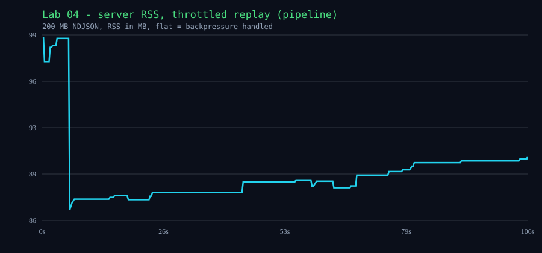

# Dogfight — FPV-дрони

Браузерна гра: дрони літають по арені, стріляють, ухиляються від астероїдів і
збирають пікапи. Репозиторій — навчальний проєкт курсу JavaScript, кожна лаба
додає один крок.

- Лаба 1 (цикл із фіксованим кроком): тег `lab-01`, див. [docs/lab-01.md](docs/lab-01.md)
- Лаба 2 (об'єкти, прототипи, `this`, композиція): тег `lab-02`, цей README
- Лаба 3 (Promises, `async`/`await`, завантаження, лобі, звук): цей README, розділ «Лаба 3» нижче
- Лаба 4 (Node.js, `EventEmitter`, streams, WebSocket): цей README, розділ «Лаба 4» нижче

## Запуск

    npm install
    npm run dev      # Vite :5173 + Node-сервер :3001
    npm run build    # client/dist
    npm run start    # сервер віддає зібраний клієнт
    npm run test     # node:test
    npm run lint     # Biome

Керування: ←/→ або A/D — поворот, ↑ або W — тяга, Space або клік мишею — вогонь.
Супротивник — бот (червоний дрон). Рахунок: +100 за збитий дрон, +10 за астероїд.

## Структура

    client/src/main.js            збирає гру, цикл і рендер
    client/src/loop.js            фіксований крок 60 Гц (лаба 1)
    client/src/input.js           замикання над станом клавіш
    client/src/controls.js        клавіатура -> "намір" { turn, thrust, fire }
    client/src/math.js            lerp, кути, seeded-генератор випадкових чисел
    client/src/sim/vector.js      Vector2: чисті методи, що повертають нові вектори
    client/src/sim/entity.js      Entity: id, pos, vel, radius, kind, update, behaviors
    client/src/sim/ship.js        Ship extends Entity (приватний #hp, get hp, fire)
    client/src/sim/bullet.js      Bullet extends Entity (TTL)
    client/src/sim/asteroid.js    Asteroid extends Entity (відскок від крайів)
    client/src/sim/pickup.js      Pickup extends Entity (ефект за ім'ям)
    client/src/sim/explosion.js   Explosion extends Entity (масив частинок)
    client/src/sim/behaviors.js   компоненти: timedEffect, homing, таблиця EFFECTS
    client/src/sim/world.js       World поверх Map<id, Entity>
    client/src/sim/collision.js   система колізій (коло-коло, O(n²))
    client/src/sim/rules.js       що робити при зіткненні кожної пари видів
    client/src/sim/game.js        гравці, рахунок, респаун, спавн астероїдів і пікапів
    client/src/sim/bot.js         бот-замикання
    client/src/render/            canvas із devicePixelRatio, малювання по видах

Спадкування — рівно один рівень: усі типи успадковують `Entity`, глибше нікуди.

## Рішення в коді

**World і Map.** Сутності лежать у `Map<id, Entity>`. Ключі лишаються
числами (у звичайному об'єкті `1` і `"1"` — той самий ключ), немає успадкованих
ключів на кшталт `constructor`, є справжній `.size`, порядок вставки гарантований,
а часті додавання й видалення швидші. `World` ітерується через
`[Symbol.iterator]`, а `*ofKind(kind)` — генератор, який не створює проміжний масив.

**Відкладене видалення.** `despawn(id)` лише ставить `alive = false`, а видаляє
мертвих `#sweep()` наприкінці `step`. Крок працює зі знімком сутностей
(`#snapshot`, один буфер, що перевикористовується): сутності, створені посеред
кроку (наприклад, куля від `fire()`), у цьому кроці вже не оновлюються, а
з'являються в наступному. Без знімка `Map` віддавав би нові елементи прямо в
поточну ітерацію, і куля рухалась би зайвий крок.

**Інтерполяція.** Перед кожним кроком кожна сутність зберігає `prevPos` і
`prevAngle`. Оскільки методи `Vector2` не мутують, для цього досить скопіювати
посилання, без клонування. Рендер змішує попередній і поточний стани за `alpha`
з циклу. Якщо сутність «телепортувалась» через край арени, змішування пропускається.

**Наміри замість клавіш.** Керування і бот повертають однакові об'єкти
`{ turn, thrust, fire }`. Корабель нічого не знає про клавіатуру, тому логіка
лишається без DOM, і її можна запускати в Node.

**Детермінованість.** Усе випадкове (астероїди, респаун, частинки) бере числа з
`createRng(seed)`. Ті самі seed і ті самі входи дають ту саму гру; це знадобиться
для мультиплеєра.

**Колізії.** `findCollisions(entities)` — окрема функція, яка лише повертає пари,
що перетинаються. Правила (`rules.js`) вирішують, що з парою робити, за таблицею
`Map` ключів на кшталт `"bullet:ship"`. Перехід на просторове хешування змінить
тільки `collision.js`.

## Bug із `this`

`this` визначається місцем виклику, а не тим, чий це метод. Куля стріляється
методом `Ship.fire()`, який звертається до `this.world`, `this.cooldown` тощо.
Коли я підключив обробник кліка так:

    canvas.addEventListener("pointerdown", ship.fire);

я передав саму функцію, а не виклик. Браузер викликає обробник як
`handler.call(canvas, event)`, тобто `this` стає елементом canvas, а не кораблем.
Це правило 3 «неявне прив'язування» для `canvas.handler()`: об'єкт зліва від
крапки. Без захисту `fire()` мовчки нічого б не робив (бо `canvas.alive`
дорівнює `undefined`). Тому на початку `fire()` стоїть перевірка
`this instanceof Ship`, і баг видно відразу. Відтворення: відкрити
`/?naive=1` і клікнути по canvas. У консолі:

    Uncaught TypeError: Ship.fire() called with wrong this: [object HTMLCanvasElement]

Так само поламається `setTimeout(ship.fire, 100)` і `const f = ship.fire; f()`:
там виклик «простий» (правило 4), і у модулях та класах (суворий режим)
`this === undefined`.

Три виправлення та їхні мінуси:

1. **Стрілка-обгортка** `() => ship.fire()`. Виклик знову має вигляд
   `ship.fire()`, тому `this` — корабель. Мінус: одна додаткова функція на
   обробник; якщо кораблем є змінна, що пізніше змінюється, обгортка тримає
   стару змінну (див. нижче). _Обране рішення._
2. **`ship.fire.bind(ship)`** — повертає копію функції з постійно прив'язаним
   `this`. Мінус: створює нову функцію щоразу, зберігає прив'язку до конкретного
   корабля (після респауну це вже інший об'єкт, тобто застарілий), а
   `removeEventListener` працює лише якщо зберегти саме це посилання.
3. **Поле класу зі стрілкою** `fire = () => { … }`. Стрілка не має власного
   `this`, захоплює його лексично з конструктора, тому `this` завжди
   правильний, і `bind` на неї не діє. Мінус: стрілка створюється для кожного
   екземпляра (пам'ять, а не спільний метод на прототипі), і її не можна
   перевизначити у підкласі через `super.fire()`.

У коді вибрано варіант 1 з додатковою деталлю: обробник дістає корабель гравця
під час кліка (`me().ship?.fire()`), бо після загибелі й респауну це новий об'єкт
`Ship`, і варіанти 2 та 3 (прив'язка в момент створення) тримали б старий,
мертвий корабель.

## Композиція замість ієрархії класів

**Що вимагалося.** Дві можливості, які ламають дерево класів: самонаведення
(куля й астероїд) і пікап (нерухомий, зіштовхується, але не корабель).

**Як виглядала б ієрархія.** Спадкування за можливостями породжує комбінації:

    Entity → MovingEntity → Bullet → HomingBullet
                          → Asteroid → HomingAsteroid
                          → Ship → ShieldedShip → RapidFireShip → …
    Entity → StaticEntity → Pickup → ShieldPickup, RapidPickup, …

`HomingBullet` і `HomingAsteroid` дублювали б одну й ту саму логіку
самонаведення, а спільного предка, який рухається й «самонаводиться», довелося б
вставляти між `MovingEntity` і всіма іншими, тобто змушувати всіх нести те, що
їм не потрібно. Корабель зі щитом і скорострільністю одночасно дав би клас
для кожної комбінації. Додавання нової можливості зачіпало б усе дерево.

**Що вибрано.** Компоненти як поля: у кожної сутності є масив `behaviors` з
малих незалежних об'єктів `{ name, done, update(owner, dt) }`. `Entity.update`
просто запускає їх. Самонаведення — одна функція `homing({ canTarget, … })`, яка
потребує від власника лише `pos`, `vel` і `world`, тому підходить і кулі
(`Ship.fire()` додає її під час ефекту «самонавідні кулі»), і астероїду (`Game`
додає її чверті астероїдів). Тимчасові ефекти (`shield`, `rapid`,
`homingShots`, `invuln`) — це `timedEffect(name, duration)`.

**Пікап** — звичайний `Pickup extends Entity` (один рівень), але те, що він
робить, не підклас, а _дані_: поле `effect` зберігає назву, а що вона означає,
записано в таблиці `EFFECTS`. Додати новий пікап — додати рядок у таблицю, без
нового класу. Така форма «поведінка як дані» ще й легко серіалізується, що
знадобиться в лабі 5.

**Ціна.** Типи поведінок перевіряються під час виконання (`entity.control?.()`,
`hasBehavior("shield")`), а не компілятором; потрібно слідкувати за іменами.
Виклики `hasBehavior` — це пошук у короткому масиві; для сотень сутностей це
дрібниця, для тисяч варто було б перейти на бітові маски. Натомість нові
можливості додаються без зміни існуючих класів, а ієрархія лишається плоскою.

## Прототипи, одним реченням

Метод `update` лежить один раз у `Entity.prototype` (так само `Ship.prototype`
і т. д.), а не копіюється у кожну кулю: пошук іде від об'єкта до прототипа.

## Лаба 3 — асинхронність: завантаження, лобі, звук

Умови: [`lab-03-async-javascript.md`](../Programming-Practice-Projects/courses/javascript/lab-03-async-javascript.md),
нотатки: [`lab-03-async-javascript.notes.md`](../Programming-Practice-Projects/courses/javascript/lab-03-async-javascript.notes.md).

### Що додано

**M1 — асети й екран завантаження.** `public/assets/manifest.json` перелічує
спрайтшит, чотири WAV-звуки й опис арени; усі файли згенеровані локально, без
мережі. `client/src/assets/loader.js` містить `fetchJson` (перевіряє `response.ok`),
`loadImage`, `loadAudio`, `loadJson` (кожен приймає `AbortSignal`), `withRetry`
(експоненційний backoff із джитером, 429/5xx — так, 4xx і скасування — ні) і
`loadAll` через `Promise.all` із лічильником прогресу. Обов'язковий спрайтшит
блокує старт і дає кнопку «Повторити»; звуки й арена необов'язкові — гра
стартує з векторним fallback-малюнком і дефолтною ареною. Екран малюється на
canvas (`client/src/ui/loading.js`) справжнім баром `done/total`.

**M2 — спрайти й звук.** `client/src/render/sprites.js` ріже аркуш на 4 кадри
(`drawImage` з прямокутником джерела); `client/src/render/draw.js` малює дрон, кулю,
астероїд і пікап спрайтами, лишаючи старий векторний шлях як запасний.
`client/src/audio/audio.js` тримає `AudioContext`, декодує буфери ще на екрані
завантаження і запускає звук лише після жесту («Приєднатися» в лобі).
Симуляція не імпортує аудіо чи HUD: `Ship.fire()` і `rules.js` пишуть події у
`world.emit`, `Game.processEvents()` передсилає їх у `EventTarget`-шину
(`client/src/events/bus.js`), а `audio.js` і `client/src/ui/hud.js` слухають `fired`, `hit`,
`exploded`, `pickup`, `scoreChanged`.

**M3 — лобі.** `server/data/rooms.json` — три кімнати зі своїми seed і розміром
арени. `client/src/net/lobby.js` (`extends EventTarget`) робить `refresh()` кожні 4 с,
кожен запит має `AbortSignal.any([controller.signal, AbortSignal.timeout(6000)])`,
а `leave()` все скасовує — осиротілих відповідей немає. Рендеринг лобі
повністю окремий: `client/src/ui/lobbyView.js` лише слухає події. Вибір кімнати задає
seed, арену і кількість астероїдів для нової `Game`.

**M4 — головоломки й галерея.** Нижче. Тег `lab-03` створюється після
фінальної перевірки.

### Режими для перевірки

| URL              | Що відбувається                                                   |
| ---------------- | ----------------------------------------------------------------- |
| `/`              | звичайне завантаження                                             |
| `/?slow=3`       | три повільні (2,5 с) JSON-асети — прогрес і паралелізм            |
| `/?fail=404`     | обов'язковий спрайт віддає 404 — помилка + «Повторити»            |
| `/?fail=json`    | арена з бітим JSON — попередження, гра стартує з дефолтною ареною |
| `/?fail=timeout` | `AbortSignal.timeout(800)` на повільному асеті                    |
| `/?fail=abort`   | натисни «Скасувати» під час повільного асета                      |
| `/?retry=1`      | `/debug/flaky` двічі віддає 503, потім успіх                      |
| `/?sequential=1` | `loadAll` чекає асети один за одним                               |
| `/?naive=1`      | старий баг із `this` із Лаби 2                                    |

Debug-ендпоїнти (`/debug/slow`, `/debug/badjson`, `/debug/404`, `/debug/flaky`)
живуть у `vite.config.js` і працюють у dev та preview.

### Послідовно vs `Promise.all`

Замір fetch-етапу на локальному dev-сервері (Node 26, 6 звичайних асетів;
повільний асет = 2500 мс):

    default:   sequential=81 ms,   Promise.all=50 ms,   delta=31 ms   (6 assets)
    with 3 slow: sequential=7562 ms, Promise.all=2516 ms, delta=5046 ms (9 assets)

Різниця не в слові `await`, а в моменті старту: `const a = await loadA();
const b = await loadB()` запускає B після A; `Promise.all([loadA(), loadB()])`
стартує обидві одразу. У браузері той самий замір друкується в консоль як
`[loadAll] concurrent: … ms` / `[loadAll] sequential: … ms`.

### П'ять головоломок порядку

**1. `await null` завжди віддає чергу**

```js
async function f() {
	console.log(1);
	await null;
	console.log(2);
}
f();
console.log(3); // 1, 3, 2
```

`2` — продовження-мікрозадача, а не продовження поточного повороту.

**2. `setTimeout` усередині `.then`**

```js
setTimeout(() => console.log("timer"), 0);
Promise.resolve()
	.then(() => {
		setTimeout(() => console.log("nested timer"), 0);
		console.log("then");
	})
	.then(() => console.log("then2"));
console.log("sync");
// sync, then, then2, timer, nested timer
```

Уся мікрочерга йде до першої задачі; вкладений таймер стає в чергу після вже
запланованого `timer`.

**3. `requestAnimationFrame` vs мікрозадача vs таймер**

```js
Promise.resolve().then(() => console.log("micro"));
requestAnimationFrame(() => console.log("raf"));
setTimeout(() => console.log("timer"), 0);
console.log("sync"); // sync, micro, далі raf/timer — порядок не гарантований
```

Мікрозадача — завжди перед обома; `raf` прив'язаний до paint, `timer` — до черги
задач.

**4. Забутий `return` у ланцюжку**

```js
Promise.resolve(1)
	.then((n) => {
		Promise.resolve(n + 1);
	})
	.then((n) => console.log("forgot", n));
Promise.resolve(1)
	.then((n) => Promise.resolve(n + 1))
	.then((n) => console.log("returned", n));
// forgot undefined, returned 2
```

Ланцюг чекає повернутого значення; без `return` далі приходить `undefined`.

**5. `Promise.all` падає, але сусіди не зупиняються**

```js
const slow = new Promise((r) =>
	setTimeout(() => {
		console.log("slow done");
		r("s");
	}, 100),
);
Promise.all([slow, Promise.reject(new Error("fast"))]).catch((e) =>
	console.log("all", e.message),
);
// all fast, slow done
```

`all` не скасовує інші проміси; для часткових відмов треба `allSettled`.

### Галерея відмов

Логи знято запуском `client/src/assets/loader.js` проти dev-сервера:

| Режим      | Лог                                                      | Відновлення                                                                  |
| ---------- | -------------------------------------------------------- | ---------------------------------------------------------------------------- |
| 404        | `HttpError: HTTP 404 for …/debug/404 (status 404)`       | 4xx не ретраїться; екран показує «Повторити», гра не стартує без спрайта     |
| битий JSON | `Error: Invalid JSON in …/debug/badjson`                 | необов'язковий асет пропущено, `World` бере дефолтну арену 1600×900          |
| timeout    | `TimeoutError: The operation was aborted due to timeout` | асет пропущено з попередженням у прогресі, гра стартує                       |
| abort      | `AbortError: This operation was aborted`                 | «Завантаження скасовано», кнопка «Повторити» створює новий `AbortController` |
| 503 ×2     | `retry 503: OK {"ok":true,"attempts":3}`                 | `withRetry` робить два повтори з backoff + jitter і всі встигає скасувати    |

Критичне правило: `fetch` на 404 **виконується** (заголовки прийшли), тому
`fetchJson` сам кидає `HttpError`; тіло читається другим `await`, а 404 — це
не мережева помилка.

## Лаба 4 — Node.js: `EventEmitter`, streams, WebSocket

### M1 — HTTP і workspaces

Репозиторій розділено на npm workspaces: `client/` (Vite-застосунок із лоб 1–3)
і `server/` (`node:http` + `ws`). Root-скрипти: `npm run dev` запускає обидва
процеси через `scripts/dev.mjs`, `npm run build` збирає `client/dist`,
`npm run start` віддає збірку через Node, `npm run test` запускає `node:test`.

    server/src/index.js        HTTP-сервер, graceful shutdown, підключення WS і логів
    server/src/config.js       PORT/HOST/LOG_DIR та ліміти з process.env, валідація
    server/src/http/router.js  /health, /api/rooms, /api/replays, /api/slow
    server/src/http/static.js  статика client/dist, MIME, захист від ..
    server/src/rooms.js        Room extends EventEmitter, RoomManager
    server/src/protocol.js     JSON v1, decodeClientMessage(), close codes
    server/src/ws.js           join/leave/chat, heartbeat, rate limit, bufferedAmount
    server/src/log/            NDJSON Transform + stream-реплей
    server/scripts/            відтворюваний RSS-бенчмарк
    server/test/               node:test (конфіг, протокол, кімнати, логи, WS)

Конфіг читається з оточення, приклад — `server/.env.example`; запуск використовує
`node --env-file-if-exists=.env`, щоб сервер стартував і без локального `.env`.
`LOG_DIR` за замовчуванням `.logs/` (ігнорується Git). На `SIGINT`/`SIGTERM`
сервер закриває WebSocket'и, дописує log-pipelines, закриває HTTP і виходить
з кодом 0.

У dev-режимі `client/vite.config.js` проксує `/api` і `/ws` на
`http://127.0.0.1:3001`; `/health` не проксується, його треба відкривати напряму
на `http://127.0.0.1:3001/health`. У продакшені всі шляхи обслуговує Node.

| Endpoint                                   | Що робить                                                              |
| ------------------------------------------ | ---------------------------------------------------------------------- |
| `GET /health`                              | `{ ok, uptimeMs, rss, rooms, wsClients, droppedMessages, activeLogs }` |
| `GET /api/rooms`, `POST /api/rooms`        | список живих кімнат / створення з валідацією тіла (кап 8 KB)           |
| `GET /api/replays`, `GET /api/replays/:id` | список NDJSON-логів / потокове віддання файлу                          |
| `GET /api/slow`                            | навмисний `BLOCK_MS` busy-loop для демонстрації event loop             |
| `GET /`, `/assets/*`                       | статика з `client/dist`, MIME + захист від `../` і `%2e%2e`            |

### M2 — кімнати, протокол і WebSocket

`Room` — `EventEmitter` із подіями `join`, `leave`, `chat`, `event`, `empty`;
порожня кімната видаляється `RoomManager` через подію `empty`. Клієнтський
`client/src/net/connection.js` тримає чергу `send` під час підключення,
робить reconnect з експоненційною паузою + jitter і повторює `join` після
перепідключення. Чат доступний у лобі й поверх гри через один і той самий
socket.

Кожне повідомлення має `{ v: 1, type, ... }`; сервер перевіряє версію, тип,
форми полів і розмір. Невідомий тип / зламана форма → `4001`, oversize →
`4002` (або `1009` від `ws` з `maxPayload`), прострочений `join` (5 с) →
`4003`, перевищення ліміту → `4004`, чат без кімнати → `4005`, невідома
кімната → `4006`, політика → `4007`, shutdown → `4008`. Повільний клієнт
отримує `1013`. Ping раз на 15 с, два пропущені pong → `terminate()`.
На кожному socket і на всіх emitter'ах, які можуть помилятися, висить
слухач `error`.

Ручна перевірка двома `ws`-клієнтами дала:

    HELLO {"v":1,"type":"hello","protocol":1,"joinTimeoutMs":700}
    A_TYPES ["hello","welcome","roster","roster","chat"]
    B_CHAT {"v":1,"type":"chat",...,"text":"привіт з лаби 4"}
    BAD_CLOSE 4001
    JOIN_TIMEOUT_CLOSE 4003
    OVERSIZE_CLOSE 1009

### M3 — логи як потоки

Кожна кімната має object-mode `PassThrough`, у який синхронно потрапляють
події `room.on("event")`. Ланцюг `PassThrough → JsonLinesTransform →
createWriteStream(LOG_DIR/<room>-<timestamp>.ndjson)` зібраний через
`pipeline()` з `node:stream/promises`: він сам тримає backpressure, передає
помилки й закриває stream'и. `GET /api/replays/:id` віддає файл через
`pipeline(createReadStream(filePath), res)` — у пам'ять нічого не читається;
`readNdjson()` — окремий async-генератор для тестів і розбору рядків.

### M4 — зловживання, RSS і event loop

Ліміти за замовчуванням: 20 повідомлень/с на з'єднання (token bucket),
`maxPayload = 4096`, 8 гравців на кімнату, 50 кімнат, тіло POST до 8 KB.
Якщо `socket.bufferedAmount > 1 MB`, некритичні повідомлення відкидаються
(`droppedMessages` у `/health`); понад 4 MB — критичне повідомлення не шлеться,
socket закривається з `1013`.

Графік знято так: `server/scripts/bench-backpressure.js` генерує 200 MB NDJSON,
качає його через `/api/replays/:id` повільним reader'ом (256 KB на 16 мс) і
опитує `/health` кожні 250 мс. Результат: 200 MB за 105.8 с, 423 заміри.



Сирі дані: [docs/assets/lab-04-rss.csv](docs/assets/lab-04-rss.csv). Після
первісного прогрівання RSS тримається близько 86–99 MB і не росте разом із
обсягом відданих даних: `pipeline` не дає файловому потоку випередити повільного
споживача. Відтворити: `node server/scripts/bench-backpressure.js`
(змінні `BENCH_BYTES`, `BENCH_THROTTLE_MS`, `BENCH_SAMPLE_MS`).

**Що буде, якщо HTTP-обробник займе цикл подій на 300 мс.** Усі клієнти
зависнуть: JS в Node однопотоковий, тому під час `busyWait()` у `/api/slow`
не виконуються ні WS-колбеки, ні таймери heartbeat, ні нові запити. Показовий
замір із чатом паралельно з `/api/slow?ms=300`:

    GET /api/slow?ms=300 -> {"ok":true,"blockedMs":300}
    WS chat echo latency -> 455 ms (зазвичай 1–5 ms)

Фази циклу: timers → pending callbacks → poll (I/O) → check (`setImmediate`) →
close callbacks; між фазами висмоктуються `process.nextTick`, потім мікрозадачі
промісів. П'ять запусків на головному модулі дали стабільне `n p t i`, але
порядок `setTimeout(0)` vs `setImmediate` з головного модуля **не гарантований**
(Node вибирає фазу старту); усередині I/O-колбека `setImmediate` виконується
перед `setTimeout(0)`.

**Чому `error` без слухача валить процес.** `emit("error")` — звичайна подія,
але EventEmitter має спеціальне правило: якщо слухача немає, помилка
перекидається синхронно й стає uncaught exception. Демонстрація на Node 26:

    node:events:505
        throw er; // Unhandled 'error' event
    Error: boom
    ...
    Node.js v26.12.1

Зі слухачем процес живий:

    caught: boom
    alive

Еквівалент для промісів — unhandled rejection: у Node вона теж завершує процес.
Тому `ws`-сокети, HTTP/server, Room/RoomManager і log-потоки мають `error`-слухачів,
а `pipeline()` використовується замість ручного `.pipe()`.

**Backpressure** — це ситуація, коли продюсер швидший за споживача.
`writable.write(chunk)` повертає `false`, коли внутрішній буфер перевищив
`highWaterMark`: далі треба чекати події `drain`. Якщо ігнорувати `false` й
продовжувати писати, буфер росте без межі й RSS процесу зростає до OOM.
`pipeline()` сам зупиняє читання з source, чекає `drain` і гарантує cleanup.
У цій лабі backpressure показався двічі: у replay-ендпоінті (файл → повільний
HTTP-клієнт) і в політиці `bufferedAmount` для WS-сокета.

### Reflection

1. Фази: timers (`setTimeout`/`setInterval`) → pending callbacks → poll (I/O) →
   check (`setImmediate`) → close callbacks. `process.nextTick` і Promise-реакції
   висмоктуються між фазами, причому nextTick перед мікрозадачами; надмірне
   `nextTick` може starve-ити I/O. `setTimeout(0)` vs `setImmediate` з головного
   модуля нестабільне, бо перша фаза циклу залежить від того, чи вже є прострочені
   таймери на момент старту.
2. Ваш JS виконується на одному потоці; файлові операції й DNS йдуть через
   libuv-ThreadPool (за замовчуванням 4 потоки), а колбек повертається в poll-фазу.
   Пул не виконує ваш JS, не прискорює CPU-роботу і не стосується мережевих
   сокетів (їх libuv опитує без пулу). Для CPU є `worker_threads`.
3. CommonJS: `require()`/`module.exports`, синхронне резолвлення, історична
   модель Node. ESM: `import`/`export`, статичні залежності, працює і в браузері.
   Ще: у CJS є `__dirname`, `require.cache`; в ESM — `import.meta.url` і
   `import.meta.dirname` (Node 20.11+), який і замінив `__dirname`.
4. `write()` повертає `false` — сигнал «буфер повний, почекай `drain`». Якщо
   продовжувати писати, `writableLength` і RSS ростуть. `pipeline()` прив'язує
   `drain`, помилки та закриття потоків автоматично.
5. Readable — джерело байтів/об'єктів, Writable — приймач, Duplex — обидва,
   Transform — Duplex, що перетворює дані на ходу (наш NDJSON-енкодер). TCP/WebSocket
   socket — Duplex.
6. WebSocket починається як HTTP `Upgrade: websocket` з `Sec-WebSocket-Key`;
   сервер відповідає `101 Switching Protocols`, далі йдуть кадри (text/binary/
   ping/pong/close) поверх одного TCP-з'єднання. Гра обирає WS, бо сервер сам
   штовхає оновлення з низькою затримкою; polling витрачає запити, а SSE —
   односторонній і не дає клієнту надсилати події так само просто.
7. `"error"` без слухача стає uncaught exception і валить процес (див. лог вище);
   для промісів еквівалент — unhandled rejection. Тому listenери висять на всіх
   emitter'ах, що можуть помилятися.
8. На 2G `bufferedAmount` сокета росте, бо сервер шле 30 snapshot/с швидше, ніж
   клієнт устигає читати. Це видно в `/health` (`droppedMessages`) і в самому
   `socket.bufferedAmount`. Варіанти: drop некритичних повідомлень, зменшити
   частоту/детальність, backpressure через `drain`, або закрити повільного
   клієнта (у нас `1013`).
9. Клієнт — не довірений вхід: його можна підмінити, він може бути застарілим
   або мати баг. Валідація на сервері тримає протокол у межах форми, розміру й
   версії й не дає одному гравцю зламати кімнату чи інших гравців.

### Prove it to yourself

    node -e "setTimeout(()=>console.log('t'),0); setImmediate(()=>console.log('i')); process.nextTick(()=>console.log('n')); Promise.resolve().then(()=>console.log('p'))"
    node -e "const { EventEmitter } = require('node:events'); new EventEmitter().emit('error', new Error('boom'))"
    node -e "console.log(Buffer.from('привіт').length, 'привіт'.length, Buffer.from([0xff,0x00]).readUInt16BE(0))"
    npm run test
    node server/scripts/bench-backpressure.js

Останній рядок дає `12 6 65280`: `Buffer` рахує байти UTF-8, а `.length` —
символи; `readUInt16BE` читає `0xff00` = 65280. У лабі 5 це стане частиною
бінарного протоколу.
