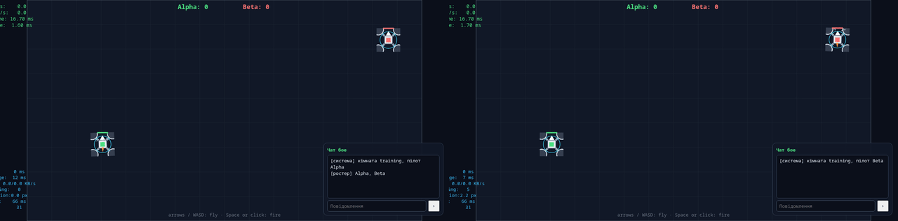
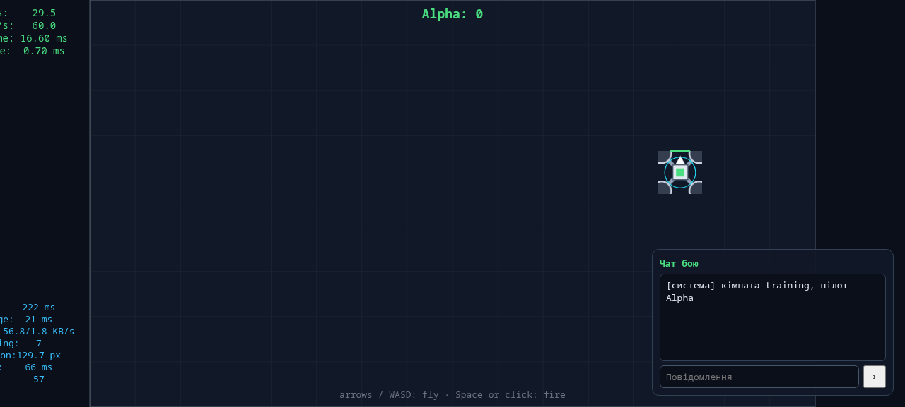

# Dogfight — FPV-дрони

Браузерна гра: дрони літають по арені, стріляють, ухиляються від астероїдів і
збирають пікапи. Репозиторій — навчальний проєкт курсу JavaScript, кожна лаба
додає один крок.

- Лаба 1 (цикл із фіксованим кроком): тег `lab-01`, див. [docs/lab-01.md](docs/lab-01.md)
- Лаба 2 (об'єкти, прототипи, `this`, композиція): тег `lab-02`, цей README
- Лаба 3 (Promises, `async`/`await`, завантаження, лобі, звук): цей README, розділ «Лаба 3» нижче
- Лаба 4 (Node.js, `EventEmitter`, streams, WebSocket): цей README, розділ «Лаба 4» нижче
- Лаба 5 (authoritative server, prediction, interpolation, binary protocol): цей README, розділ «Лаба 5» нижче
- Лаба 6 (strict TypeScript, typed protocol, runtime validation): тег `lab-06`, цей README, розділ «Лаба 6» нижче
- Лаба 7 (тестування, профілювання й оптимізація): цей README, розділ «Лаба 7» нижче

[](https://github.com/OleksiiZench/dogfight/actions/workflows/ci.yml)



## Запуск

    npm install
    npm run dev      # Vite :5173 + Node-сервер :3001
    npm run build    # client/dist
    npm run start    # сервер віддає зібраний клієнт
    npm run test     # Vitest: client + server + shared
    npm run coverage # Vitest coverage, поріг 85%
    npm run test:e2e # Playwright: два клієнти в одній кімнаті
    npm run lint     # Biome
    npm run typecheck # root + client + server + shared (tsc --noEmit)
    npm run benchmark:netcode  # JSON vs binary, 30 Гц, 4 гравці
    npm run record:netcode     # 20-секундний GIF двох вікон (потрібен ffmpeg)
    npm run profile:browser    # headless-профілювання кадрів
    npm run worker:experiment  # clone vs transfer у Worker
    npm run loadtest           # навантаження сервера

Керування: ←/→ або A/D — поворот, ↑ або W — тяга, Space або клік мишею — вогонь.
Супротивник — бот (червоний дрон). Рахунок: +100 за збитий дрон, +10 за астероїд.

## Структура

    tsconfig.base.tson            strict TS-опції для всього workspace
    shared/src/types.ts           брендовані id, Result, ProtocolFailure, assertNever
    shared/src/protocol/schema.ts Zod v4 — source of truth для JSON-повідомлень
    shared/src/protocol/codec.ts  DataView v1, little-endian, перевірка діапазонів
    shared/src/protocol.ts        публічний фасад: parse*, codecs, ProtocolError
    shared/src/sim/               детермінований світ, сутності, колізії, правила, Game
    server/src/config.ts          env-конфіг через Zod-схему з дефолтами
    server/src/index.ts           HTTP + WS, graceful shutdown
    server/src/ws.ts              join/leave/chat, heartbeat, rate limit
    server/src/match.ts           authoritative tick, input seq, реплеї
    server/src/rooms.ts           Room extends EventEmitter, RoomManager
    server/src/http/, log/        API, статика, NDJSON-логи й replay
    client/src/main.ts            збирає завантаження, лобі, гру, цикл і рендер
    client/src/loop.ts            фіксований крок 60 Гц (лаба 1)
    client/src/net/               connection, lobby, matchView, predictor
    client/src/render/, ui/       canvas із devicePixelRatio, HUD, лобі, чат
    client/src/audio/, assets/    звук і завантаження асетів з AbortSignal
    scripts/                      dev, benchmark-codec, record-netcode, profile-frame, worker-experiment
    server/scripts/loadtest.mts   headless WebSocket-клієнти й графік ємності

Спадкування — рівно один рівень: усі типи успадковують `Entity`, глибше нікуди.

## Рішення в коді

**World і Map.** Сутності лежать у `Map<id, Entity>`. Ключі лишаються
числами (у звичайному об'єкті `1` і `"1"` — той самий ключ), немає успадкованих
ключів на кшталт `constructor`, є справжній `.size`, порядок вставки гарантований,
а часті додавання й видалення швидші. `World` ітерується через
`[Symbol.iterator]`, а `*ofKind(kind)` — генератор, який не створює проміжний масив.

**Відкладене видалення.** `despawn(id)` лише ставить `alive = false`, а видаляє
мертвих `#sweep()` наприкінці `step`. Крок працює зі знімком сутностей
(`#snapshot`, один буфер, що перевикористовується): сутності, створені посеред
кроку (наприклад, куля від `fire()`), у цьому кроці вже не оновлюються, а
з'являються в наступному. Без знімка `Map` віддавав би нові елементи прямо в
поточну ітерацію, і куля рухалась би зайвий крок.

**Інтерполяція.** Перед кожним кроком кожна сутність копіює `pos`/`angle` у
власні `prevPos`/`prevAngle`. Після профілювання гарячі шляхи перейшли на
in-place `Vector2` (`set`, `addInPlace`, `scaleInPlace`), тому спільне посилання
більше не працює: мутація `pos` зіпсувала б `prevPos`. Рендер змішує попередній і
поточний стани за `alpha` з циклу, перевикористовуючи один `renderCache`, а не
новий `Vector2` щокадру. Якщо сутність «телепортувалась» через край арени,
змішування пропускається.

**Наміри замість клавіш.** Керування і бот повертають однакові об'єкти
`{ turn, thrust, fire }`. Корабель нічого не знає про клавіатуру, тому логіка
лишається без DOM, і її можна запускати в Node.

**Детермінованість.** Усе випадкове (астероїди, респаун, частинки) бере числа з
`createRng(seed)`. Ті самі seed і ті самі входи дають ту саму гру; це знадобиться
для мультиплеєра.

**Колізії.** `findCollisions(entities)` — окрема функція, яка лише повертає пари,
що перетинаються. Правила (`rules.ts`) вирішують, що з парою робити, за таблицею
`Map` ключів на кшталт `"bullet:ship"`. Після профілювання `O(n²)`-перебір
замінено просторим хешем із коміркою 128 px у `collision.ts`; правила не змінилися.

## Bug із `this`

`this` визначається місцем виклику, а не тим, чий це метод. Куля стріляється
методом `Ship.fire()`, який звертається до `this.world`, `this.cooldown` тощо.
Коли я підключив обробник кліка так:

    canvas.addEventListener("pointerdown", ship.fire);

я передав саму функцію, а не виклик. Браузер викликає обробник як
`handler.call(canvas, event)`, тобто `this` стає елементом canvas, а не кораблем.
Це правило 3 «неявне прив'язування» для `canvas.handler()`: об'єкт зліва від
крапки. Без захисту `fire()` мовчки нічого б не робив (бо `canvas.alive`
дорівнює `undefined`). Тому на початку `fire()` стоїть перевірка
`this instanceof Ship`, і баг видно відразу. Відтворення: відкрити
`/?naive=1` і клікнути по canvas. У консолі:

    Uncaught TypeError: Ship.fire() called with wrong this: [object HTMLCanvasElement]

Так само поламається `setTimeout(ship.fire, 100)` і `const f = ship.fire; f()`:
там виклик «простий» (правило 4), і у модулях та класах (суворий режим)
`this === undefined`.

Три виправлення та їхні мінуси:

1. **Стрілка-обгортка** `() => ship.fire()`. Виклик знову має вигляд
   `ship.fire()`, тому `this` — корабель. Мінус: одна додаткова функція на
   обробник; якщо кораблем є змінна, що пізніше змінюється, обгортка тримає
   стару змінну (див. нижче). _Обране рішення._
2. **`ship.fire.bind(ship)`** — повертає копію функції з постійно прив'язаним
   `this`. Мінус: створює нову функцію щоразу, зберігає прив'язку до конкретного
   корабля (після респауну це вже інший об'єкт, тобто застарілий), а
   `removeEventListener` працює лише якщо зберегти саме це посилання.
3. **Поле класу зі стрілкою** `fire = () => { … }`. Стрілка не має власного
   `this`, захоплює його лексично з конструктора, тому `this` завжди
   правильний, і `bind` на неї не діє. Мінус: стрілка створюється для кожного
   екземпляра (пам'ять, а не спільний метод на прототипі), і її не можна
   перевизначити у підкласі через `super.fire()`.

У коді вибрано варіант 1 з додатковою деталлю: обробник дістає корабель гравця
під час кліка (`me().ship?.fire()`), бо після загибелі й респауну це новий об'єкт
`Ship`, і варіанти 2 та 3 (прив'язка в момент створення) тримали б старий,
мертвий корабель.

## Композиція замість ієрархії класів

**Що вимагалося.** Дві можливості, які ламають дерево класів: самонаведення
(куля й астероїд) і пікап (нерухомий, зіштовхується, але не корабель).

**Як виглядала б ієрархія.** Спадкування за можливостями породжує комбінації:

    Entity → MovingEntity → Bullet → HomingBullet
                          → Asteroid → HomingAsteroid
                          → Ship → ShieldedShip → RapidFireShip → …
    Entity → StaticEntity → Pickup → ShieldPickup, RapidPickup, …

`HomingBullet` і `HomingAsteroid` дублювали б одну й ту саму логіку
самонаведення, а спільного предка, який рухається й «самонаводиться», довелося б
вставляти між `MovingEntity` і всіма іншими, тобто змушувати всіх нести те, що
їм не потрібно. Корабель зі щитом і скорострільністю одночасно дав би клас
для кожної комбінації. Додавання нової можливості зачіпало б усе дерево.

**Що вибрано.** Компоненти як поля: у кожної сутності є масив `behaviors` з
малих незалежних об'єктів `{ name, done, update(owner, dt) }`. `Entity.update`
просто запускає їх. Самонаведення — одна функція `homing({ canTarget, … })`, яка
потребує від власника лише `pos`, `vel` і `world`, тому підходить і кулі
(`Ship.fire()` додає її під час ефекту «самонавідні кулі»), і астероїду (`Game`
додає її чверті астероїдів). Тимчасові ефекти (`shield`, `rapid`,
`homingShots`, `invuln`) — це `timedEffect(name, duration)`.

**Пікап** — звичайний `Pickup extends Entity` (один рівень), але те, що він
робить, не підклас, а _дані_: поле `effect` зберігає назву, а що вона означає,
записано в таблиці `EFFECTS`. Додати новий пікап — додати рядок у таблицю, без
нового класу. Така форма «поведінка як дані» ще й легко серіалізується, що
знадобиться в лабі 5.

**Ціна.** Назви behaviors і пікапів лишаються рядками з даних, тому їх перевіряє
`hasBehavior("shield")` і Zod-схема `EffectNameSchema`, а не ієрархія класів.
Виклики `hasBehavior` — це пошук у короткому масиві; для сотень сутностей це
дрібниця, для тисяч варто було б перейти на бітові маски. Натомість нові
можливості додаються без зміни існуючих класів, а ієрархія лишається плоскою.

## Прототипи, одним реченням

Метод `update` лежить один раз у `Entity.prototype` (так само `Ship.prototype`
і т. д.), а не копіюється у кожну кулю: пошук іде від об'єкта до прототипа.

## Лаба 3 — асинхронність: завантаження, лобі, звук

Умови: [`lab-03-async-javascript.md`](../Programming-Practice-Projects/courses/javascript/lab-03-async-javascript.md),
нотатки: [`lab-03-async-javascript.notes.md`](../Programming-Practice-Projects/courses/javascript/lab-03-async-javascript.notes.md).

### Що додано

**M1 — асети й екран завантаження.** `public/assets/manifest.tson` перелічує
спрайтшит, чотири WAV-звуки й опис арени; усі файли згенеровані локально, без
мережі. `client/src/assets/loader.ts` містить `fetchJson` (перевіряє `response.ok`),
`loadImage`, `loadAudio`, `loadJson` (кожен приймає `AbortSignal`), `withRetry`
(експоненційний backoff із джитером, 429/5xx — так, 4xx і скасування — ні) і
`loadAll` через `Promise.all` із лічильником прогресу. Обов'язковий спрайтшит
блокує старт і дає кнопку «Повторити»; звуки й арена необов'язкові — гра
стартує з векторним fallback-малюнком і дефолтною ареною. Екран малюється на
canvas (`client/src/ui/loading.ts`) справжнім баром `done/total`.

**M2 — спрайти й звук.** `client/src/render/sprites.ts` ріже аркуш на 4 кадри
(`drawImage` з прямокутником джерела); `client/src/render/draw.ts` малює дрон, кулю,
астероїд і пікап спрайтами, лишаючи старий векторний шлях як запасний.
`client/src/audio/audio.ts` тримає `AudioContext`, декодує буфери ще на екрані
завантаження і запускає звук лише після жесту («Приєднатися» в лобі).
Симуляція не імпортує аудіо чи HUD: `Ship.fire()` і `rules.ts` пишуть події у
`world.emit`, `Game.processEvents()` передсилає їх у `EventTarget`-шину
(`client/src/events/bus.ts`), а `audio.ts` і `client/src/ui/hud.ts` слухають `fired`, `hit`,
`exploded`, `pickup`, `scoreChanged`.

**M3 — лобі.** `server/data/rooms.tson` — три кімнати зі своїми seed і розміром
арени. `client/src/net/lobby.ts` (`extends EventTarget`) робить `refresh()` кожні 4 с,
кожен запит має `AbortSignal.any([controller.signal, AbortSignal.timeout(6000)])`,
а `leave()` все скасовує — осиротілих відповідей немає. Рендеринг лобі
повністю окремий: `client/src/ui/lobbyView.ts` лише слухає події. Вибір кімнати задає
seed, арену і кількість астероїдів для нової `Game`.

**M4 — головоломки й галерея.** Нижче. Тег `lab-03` створюється після
фінальної перевірки.

### Режими для перевірки

| URL              | Що відбувається                                                   |
| ---------------- | ----------------------------------------------------------------- |
| `/`              | звичайне завантаження                                             |
| `/?slow=3`       | три повільні (2,5 с) JSON-асети — прогрес і паралелізм            |
| `/?fail=404`     | обов'язковий спрайт віддає 404 — помилка + «Повторити»            |
| `/?fail=json`    | арена з бітим JSON — попередження, гра стартує з дефолтною ареною |
| `/?fail=timeout` | `AbortSignal.timeout(800)` на повільному асеті                    |
| `/?fail=abort`   | натисни «Скасувати» під час повільного асета                      |
| `/?retry=1`      | `/debug/flaky` двічі віддає 503, потім успіх                      |
| `/?sequential=1` | `loadAll` чекає асети один за одним                               |
| `/?naive=1`      | старий баг із `this` із Лаби 2                                    |

Debug-ендпоїнти (`/debug/slow`, `/debug/badjson`, `/debug/404`, `/debug/flaky`)
живуть у `vite.config.ts` і працюють у dev та preview.

### Послідовно vs `Promise.all`

Замір fetch-етапу на локальному dev-сервері (Node 26, 6 звичайних асетів;
повільний асет = 2500 мс):

    default:   sequential=81 ms,   Promise.all=50 ms,   delta=31 ms   (6 assets)
    with 3 slow: sequential=7562 ms, Promise.all=2516 ms, delta=5046 ms (9 assets)

Різниця не в слові `await`, а в моменті старту: `const a = await loadA();
const b = await loadB()` запускає B після A; `Promise.all([loadA(), loadB()])`
стартує обидві одразу. У браузері той самий замір друкується в консоль як
`[loadAll] concurrent: … ms` / `[loadAll] sequential: … ms`.

### П'ять головоломок порядку

**1. `await null` завжди віддає чергу**

```js
async function f() {
	console.log(1);
	await null;
	console.log(2);
}
f();
console.log(3); // 1, 3, 2
```

`2` — продовження-мікрозадача, а не продовження поточного повороту.

**2. `setTimeout` усередині `.then`**

```js
setTimeout(() => console.log("timer"), 0);
Promise.resolve()
	.then(() => {
		setTimeout(() => console.log("nested timer"), 0);
		console.log("then");
	})
	.then(() => console.log("then2"));
console.log("sync");
// sync, then, then2, timer, nested timer
```

Уся мікрочерга йде до першої задачі; вкладений таймер стає в чергу після вже
запланованого `timer`.

**3. `requestAnimationFrame` vs мікрозадача vs таймер**

```js
Promise.resolve().then(() => console.log("micro"));
requestAnimationFrame(() => console.log("raf"));
setTimeout(() => console.log("timer"), 0);
console.log("sync"); // sync, micro, далі raf/timer — порядок не гарантований
```

Мікрозадача — завжди перед обома; `raf` прив'язаний до paint, `timer` — до черги
задач.

**4. Забутий `return` у ланцюжку**

```js
Promise.resolve(1)
	.then((n) => {
		Promise.resolve(n + 1);
	})
	.then((n) => console.log("forgot", n));
Promise.resolve(1)
	.then((n) => Promise.resolve(n + 1))
	.then((n) => console.log("returned", n));
// forgot undefined, returned 2
```

Ланцюг чекає повернутого значення; без `return` далі приходить `undefined`.

**5. `Promise.all` падає, але сусіди не зупиняються**

```js
const slow = new Promise((r) =>
	setTimeout(() => {
		console.log("slow done");
		r("s");
	}, 100),
);
Promise.all([slow, Promise.reject(new Error("fast"))]).catch((e) =>
	console.log("all", e.message),
);
// all fast, slow done
```

`all` не скасовує інші проміси; для часткових відмов треба `allSettled`.

### Галерея відмов

Логи знято запуском `client/src/assets/loader.ts` проти dev-сервера:

| Режим      | Лог                                                      | Відновлення                                                                  |
| ---------- | -------------------------------------------------------- | ---------------------------------------------------------------------------- |
| 404        | `HttpError: HTTP 404 for …/debug/404 (status 404)`       | 4xx не ретраїться; екран показує «Повторити», гра не стартує без спрайта     |
| битий JSON | `Error: Invalid JSON in …/debug/badjson`                 | необов'язковий асет пропущено, `World` бере дефолтну арену 1600×900          |
| timeout    | `TimeoutError: The operation was aborted due to timeout` | асет пропущено з попередженням у прогресі, гра стартує                       |
| abort      | `AbortError: This operation was aborted`                 | «Завантаження скасовано», кнопка «Повторити» створює новий `AbortController` |
| 503 ×2     | `retry 503: OK {"ok":true,"attempts":3}`                 | `withRetry` робить два повтори з backoff + jitter і всі встигає скасувати    |

Критичне правило: `fetch` на 404 **виконується** (заголовки прийшли), тому
`fetchJson` сам кидає `HttpError`; тіло читається другим `await`, а 404 — це
не мережева помилка.

## Лаба 4 — Node.js: `EventEmitter`, streams, WebSocket

### M1 — HTTP і workspaces

Репозиторій розділено на npm workspaces: `client/` (Vite-застосунок із лоб 1–3)
і `server/` (`node:http` + `ws`). Root-скрипти: `npm run dev` запускає обидва
процеси через `scripts/dev.mts`, `npm run build` збирає `client/dist`,
`npm run start` віддає збірку через Node, `npm run test` запускає `node:test`.

    server/src/index.ts        HTTP-сервер, graceful shutdown, підключення WS і логів
    server/src/config.ts       PORT/HOST/LOG_DIR та ліміти з process.env, валідація
    server/src/http/router.ts  /health, /api/rooms, /api/replays, /api/slow
    server/src/http/static.ts  статика client/dist, MIME, захист від ..
    server/src/rooms.ts        Room extends EventEmitter, RoomManager
    server/src/protocol.ts     JSON v1, decodeClientMessage(), close codes
    server/src/ws.ts           join/leave/chat, heartbeat, rate limit, bufferedAmount
    server/src/log/            NDJSON Transform + stream-реплей
    server/scripts/            відтворюваний RSS-бенчмарк
    server/test/               node:test (конфіг, протокол, кімнати, логи, WS)

Конфіг читається з оточення, приклад — `server/.env.example`; запуск використовує
`node --env-file-if-exists=.env`, щоб сервер стартував і без локального `.env`.
`LOG_DIR` за замовчуванням `.logs/` (ігнорується Git). На `SIGINT`/`SIGTERM`
сервер закриває WebSocket'и, дописує log-pipelines, закриває HTTP і виходить
з кодом 0.

У dev-режимі `client/vite.config.ts` проксує `/api` і `/ws` на
`http://127.0.0.1:3001`; `/health` не проксується, його треба відкривати напряму
на `http://127.0.0.1:3001/health`. У продакшені всі шляхи обслуговує Node.

| Endpoint                                   | Що робить                                                              |
| ------------------------------------------ | ---------------------------------------------------------------------- |
| `GET /health`                              | `{ ok, uptimeMs, rss, rooms, wsClients, droppedMessages, activeLogs }` |
| `GET /api/rooms`, `POST /api/rooms`        | список живих кімнат / створення з валідацією тіла (кап 8 KB)           |
| `GET /api/replays`, `GET /api/replays/:id` | список NDJSON-логів / потокове віддання файлу                          |
| `GET /api/slow`                            | навмисний `BLOCK_MS` busy-loop для демонстрації event loop             |
| `GET /`, `/assets/*`                       | статика з `client/dist`, MIME + захист від `../` і `%2e%2e`            |

### M2 — кімнати, протокол і WebSocket

`Room` — `EventEmitter` із подіями `join`, `leave`, `chat`, `event`, `empty`;
порожня кімната видаляється `RoomManager` через подію `empty`. Клієнтський
`client/src/net/connection.ts` тримає чергу `send` під час підключення,
робить reconnect з експоненційною паузою + jitter і повторює `join` після
перепідключення. Чат доступний у лобі й поверх гри через один і той самий
socket.

Кожне повідомлення має `{ v: 1, type, ... }`; сервер перевіряє версію, тип,
форми полів і розмір. Невідомий тип / зламана форма → `4001`, oversize →
`4002` (або `1009` від `ws` з `maxPayload`), прострочений `join` (5 с) →
`4003`, перевищення ліміту → `4004`, чат без кімнати → `4005`, невідома
кімната → `4006`, політика → `4007`, shutdown → `4008`. Повільний клієнт
отримує `1013`. Ping раз на 15 с, два пропущені pong → `terminate()`.
На кожному socket і на всіх emitter'ах, які можуть помилятися, висить
слухач `error`.

Ручна перевірка двома `ws`-клієнтами дала:

    HELLO {"v":1,"type":"hello","protocol":1,"joinTimeoutMs":700}
    A_TYPES ["hello","welcome","roster","roster","chat"]
    B_CHAT {"v":1,"type":"chat",...,"text":"привіт з лаби 4"}
    BAD_CLOSE 4001
    JOIN_TIMEOUT_CLOSE 4003
    OVERSIZE_CLOSE 1009

### M3 — логи як потоки

Кожна кімната має object-mode `PassThrough`, у який синхронно потрапляють
події `room.on("event")`. Ланцюг `PassThrough → JsonLinesTransform →
createWriteStream(LOG_DIR/<room>-<timestamp>.ndjson)` зібраний через
`pipeline()` з `node:stream/promises`: він сам тримає backpressure, передає
помилки й закриває stream'и. `GET /api/replays/:id` віддає файл через
`pipeline(createReadStream(filePath), res)` — у пам'ять нічого не читається;
`readNdjson()` — окремий async-генератор для тестів і розбору рядків.

### M4 — зловживання, RSS і event loop

Ліміти за замовчуванням: 20 повідомлень/с на з'єднання (token bucket),
`maxPayload = 4096`, 8 гравців на кімнату, 50 кімнат, тіло POST до 8 KB.
Якщо `socket.bufferedAmount > 1 MB`, некритичні повідомлення відкидаються
(`droppedMessages` у `/health`); понад 4 MB — критичне повідомлення не шлеться,
socket закривається з `1013`.

Графік знято так: `server/scripts/bench-backpressure.ts` генерує 200 MB NDJSON,
качає його через `/api/replays/:id` повільним reader'ом (256 KB на 16 мс) і
опитує `/health` кожні 250 мс. Результат: 200 MB за 105.8 с, 423 заміри.


Сирі дані: [docs/assets/lab-04-rss.csv](docs/assets/lab-04-rss.csv). Після
первісного прогрівання RSS тримається близько 86–99 MB і не росте разом із
обсягом відданих даних: `pipeline` не дає файловому потоку випередити повільного
споживача. Відтворити: `node server/scripts/bench-backpressure.ts`
(змінні `BENCH_BYTES`, `BENCH_THROTTLE_MS`, `BENCH_SAMPLE_MS`).

**Що буде, якщо HTTP-обробник займе цикл подій на 300 мс.** Усі клієнти
зависнуть: JS в Node однопотоковий, тому під час `busyWait()` у `/api/slow`
не виконуються ні WS-колбеки, ні таймери heartbeat, ні нові запити. Показовий
замір із чатом паралельно з `/api/slow?ms=300`:

    GET /api/slow?ms=300 -> {"ok":true,"blockedMs":300}
    WS chat echo latency -> 455 ms (зазвичай 1–5 ms)

Фази циклу: timers → pending callbacks → poll (I/O) → check (`setImmediate`) →
close callbacks; між фазами висмоктуються `process.nextTick`, потім мікрозадачі
промісів. П'ять запусків на головному модулі дали стабільне `n p t i`, але
порядок `setTimeout(0)` vs `setImmediate` з головного модуля **не гарантований**
(Node вибирає фазу старту); усередині I/O-колбека `setImmediate` виконується
перед `setTimeout(0)`.

**Чому `error` без слухача валить процес.** `emit("error")` — звичайна подія,
але EventEmitter має спеціальне правило: якщо слухача немає, помилка
перекидається синхронно й стає uncaught exception. Демонстрація на Node 26:

    node:events:505
        throw er; // Unhandled 'error' event
    Error: boom
    ...
    Node.js v26.12.1

Зі слухачем процес живий:

    caught: boom
    alive

Еквівалент для промісів — unhandled rejection: у Node вона теж завершує процес.
Тому `ws`-сокети, HTTP/server, Room/RoomManager і log-потоки мають `error`-слухачів,
а `pipeline()` використовується замість ручного `.pipe()`.

**Backpressure** — це ситуація, коли продюсер швидший за споживача.
`writable.write(chunk)` повертає `false`, коли внутрішній буфер перевищив
`highWaterMark`: далі треба чекати події `drain`. Якщо ігнорувати `false` й
продовжувати писати, буфер росте без межі й RSS процесу зростає до OOM.
`pipeline()` сам зупиняє читання з source, чекає `drain` і гарантує cleanup.
У цій лабі backpressure показався двічі: у replay-ендпоінті (файл → повільний
HTTP-клієнт) і в політиці `bufferedAmount` для WS-сокета.

### Reflection

1. Фази: timers (`setTimeout`/`setInterval`) → pending callbacks → poll (I/O) →
   check (`setImmediate`) → close callbacks. `process.nextTick` і Promise-реакції
   висмоктуються між фазами, причому nextTick перед мікрозадачами; надмірне
   `nextTick` може starve-ити I/O. `setTimeout(0)` vs `setImmediate` з головного
   модуля нестабільне, бо перша фаза циклу залежить від того, чи вже є прострочені
   таймери на момент старту.
2. Ваш JS виконується на одному потоці; файлові операції й DNS йдуть через
   libuv-ThreadPool (за замовчуванням 4 потоки), а колбек повертається в poll-фазу.
   Пул не виконує ваш JS, не прискорює CPU-роботу і не стосується мережевих
   сокетів (їх libuv опитує без пулу). Для CPU є `worker_threads`.
3. CommonJS: `require()`/`module.exports`, синхронне резолвлення, історична
   модель Node. ESM: `import`/`export`, статичні залежності, працює і в браузері.
   Ще: у CJS є `__dirname`, `require.cache`; в ESM — `import.meta.url` і
   `import.meta.dirname` (Node 20.11+), який і замінив `__dirname`.
4. `write()` повертає `false` — сигнал «буфер повний, почекай `drain`». Якщо
   продовжувати писати, `writableLength` і RSS ростуть. `pipeline()` прив'язує
   `drain`, помилки та закриття потоків автоматично.
5. Readable — джерело байтів/об'єктів, Writable — приймач, Duplex — обидва,
   Transform — Duplex, що перетворює дані на ходу (наш NDJSON-енкодер). TCP/WebSocket
   socket — Duplex.
6. WebSocket починається як HTTP `Upgrade: websocket` з `Sec-WebSocket-Key`;
   сервер відповідає `101 Switching Protocols`, далі йдуть кадри (text/binary/
   ping/pong/close) поверх одного TCP-з'єднання. Гра обирає WS, бо сервер сам
   штовхає оновлення з низькою затримкою; polling витрачає запити, а SSE —
   односторонній і не дає клієнту надсилати події так само просто.
7. `"error"` без слухача стає uncaught exception і валить процес (див. лог вище);
   для промісів еквівалент — unhandled rejection. Тому listenери висять на всіх
   emitter'ах, що можуть помилятися.
8. На 2G `bufferedAmount` сокета росте, бо сервер шле 30 snapshot/с швидше, ніж
   клієнт устигає читати. Це видно в `/health` (`droppedMessages`) і в самому
   `socket.bufferedAmount`. Варіанти: drop некритичних повідомлень, зменшити
   частоту/детальність, backpressure через `drain`, або закрити повільного
   клієнта (у нас `1013`).
9. Клієнт — не довірений вхід: його можна підмінити, він може бути застарілим
   або мати баг. Валідація на сервері тримає протокол у межах форми, розміру й
   версії й не дає одному гравцю зламати кімнату чи інших гравців.

### Prove it to yourself

    node -e "setTimeout(()=>console.log('t'),0); setImmediate(()=>console.log('i')); process.nextTick(()=>console.log('n')); Promise.resolve().then(()=>console.log('p'))"
    node -e "const { EventEmitter } = require('node:events'); new EventEmitter().emit('error', new Error('boom'))"
    node -e "console.log(Buffer.from('привіт').length, 'привіт'.length, Buffer.from([0xff,0x00]).readUInt16BE(0))"
    npm run test
    node server/scripts/bench-backpressure.ts

Останній рядок дає `12 6 65280`: `Buffer` рахує байти UTF-8, а `.length` —
символи; `readUInt16BE` читає `0xff00` = 65280. У лабі 5 це стане частиною
бінарного протоколу.

## Лаба 5 — Real-Time Networking

Умови:
[`lab-05-realtime-networking.md`](../Programming-Practice-Projects/courses/javascript/lab-05-realtime-networking.md),
нотатки:
[`lab-05-realtime-networking.notes.md`](../Programming-Practice-Projects/courses/javascript/lab-05-realtime-networking.notes.md).

Три проблеми, які вирішує ця лаба: **consistency** (два клієнти не можуть мати
різні світи), **fairness/cheating** (клієнт не має вирішувати, де він знаходиться)
і **latency** (правда сервера приходить на 80–250 мс пізніше, ніж натискання
клавіші). Перші дві дає authoritative server, третю — prediction +
reconciliation для себе й interpolation для інших.

### M1 — спільна симуляція й сервер

`shared/` — третій npm workspace; `shared/src/sim/*` працює і в Node, і у Vite
без DOM. `server/src/match.ts` запускає цю саму симуляцію з фіксованим
`dt = 1/30`, застосовує останній валідний input гравця (`seq` монотонно зростає)
і шле snapshot із `tick` та персональним `lastProcessedSeq`. Клієнт поки що
малював тільки те, що сказав сервер: при 100 мс затримки корабель реагував із
помітною затримкою. `LatencyInjector` додає base + jitter і drop до input/snapshots;
`join`, `net` і ping лишаються критичними й не відкладаються. Netgraph показує
RTT, вік snapshot, bytes/s, pending inputs і correction.

### M2 — prediction, reconciliation, determinism

Клієнт сам інтегрує свої наміри кожен серверний тік (30 Гц) і тримає чергу
непідтверджених input'ів. Коли приходить snapshot: ставимо корабель у стан
сервера, викидаємо inputs з `seq <= ack`, потім відтворюємо решту в тому ж
порядку. Різниця між передбаченим і остаточним станом потрапляє в
`connection.stats.correction`, а візуальна позиція зближується з нею за ~100 мс,
щоб приховати ривок.

Замір із `/?latency=100&jitter=30&drop=0.02`: RTT ≈ 250 мс, за перші 100 мс
корабель вже зрушив на ~4px (без prediction він би стояв), далі `y` пішов
`587.9 → 426.2`, correction ≈ 63px на зіткненнях і близько 0 у порожньому просторі.

Перевірка детермінізації: тимчасово додав `Math.random()` у
`shared/src/sim/ship.ts`, prediction і сервер розійшлися — correction підскочила
до 262px; скріншот збережено. Потім код повернуто, `npm run test` і build
перевірені знову.



### M3 — interpolation і другий гравець

`client/src/net/match.ts` тримає історію snapshot'ів і малює чужі сутності на
`now − interpolationDelay` (66 мс = два тіки при 30 Гц), беручи дві frame, що
охоплюють цей момент. Позиції й кути інтерполюються, кут — через найкоротшу дугу
(`lerpAngle`), тому перехід через `-π/π` не обертає корабель на 359°. Нові сутності
з'являються з останнього стану, зниклі — зникають без «привидів».

Кулі мають `sourceSeq`: локальна куля створюється одразу, а коли сервер підтверджує
її, передбачена копія замінюється авторитетною за цим seq; локальний owner
не малюється двічі. Двопанельний smoke з 100 мс ± 30 мс і 2% втрат показав
`predicted 1 → confirmed 1–2` і 12/12 вибірок з відставанням інтерпольованого
корабля від останнього snapshot.

### M4 — бінарний DataView-протокол

Формат описаний коментарем на початку `shared/src/protocol/codec.ts`: версія 1,
усі числа little-endian. Input — 14 байт: 2-байтовий заголовок (`version`, `type`) плюс
`seq`, `tick`, `turn` як `Int16` у 1/1000 рад, `thrust` і `fire`. Snapshot — `tick`, арена, гравці, сутності, події
як JSON-хвіст і `lastProcessedSeq`; час у мс, вік у сантисекундах, кут у
`Int16 × 1000`. Клієнт оголошує `binaryType = "arraybuffer"`; `hello` показує
`["json", "binary"]`, `join` обирає кодек, за замовчуванням binary.
`?codec=json` залишає старий JSON для порівняння; chat/ping/roster ідуть JSON.

Обидва smoke-режими пройшли: binary і JSON дали однакові predicted/confirmed
bullets, 12/12 interpolation sample, `problems: []`.

Замір `npm run benchmark:netcode` (симуляція з 4 гравцями, 10 сутностей у
snapshot):

| Метрика (30 Гц, 4 гравці) |         JSON |      Binary | Менше, % |
| ------------------------- | -----------: | ----------: | -------: |
| Snapshot, bytes           |         4267 |         692 |     83.8 |
| Downstream на клієнта     | 125.01 KiB/s | 20.27 KiB/s |     83.8 |
| Upstream на клієнта       |   2.40 KiB/s |  0.41 KiB/s |     82.9 |
| Upstream 4 гравців        |   9.61 KiB/s |  1.64 KiB/s |     82.9 |
| Input, bytes              |           82 |          14 |     82.9 |
| Encode + decode, µs       |        17.24 |       54.87 |   -218.3 |

Перемога тут у трафіку, не в CPU: цей DataView-кодек повільніше `JSON.stringify`
на невеликому повідомленні, але економить ~84% каналу. Round-trip тести
`decode(encode(msg))` звіряють числа з tolerance 0.011 (квантування кута й
форми астероїда) і точні рядки/прапорці.

Артефакти:
[GIF двох вікон](docs/assets/lab-05-two-player.gif) (20 с, 10 fps),
[скріншот корекції](docs/assets/lab-05-corrections.png),
[скрипт бенчмарку](scripts/benchmark-codec.mts),
[скрипт запису](scripts/record-netcode.mts).

### Reflection

1. **Чому сервер authoritative?** Client-authoritative має дві проблеми: гравці
   бачать різні світи (float drift, dropped packets) і клієнт може надіслати
   `{ x: 9999, y: 9999 }` або `turn: 1000`, телепортуючись/продовжуючи стріляти
   крізь стіни. Сервер приймає лише валідовані наміри й сам рахує позиції.
2. **Prediction.** Клієнт застосовує свій input до тієї самої чистої симуляції
   одразу, не чекаючи сервера. Потрібна детермінованість: ті самі стан і входи
   дають той самий результат. Порушення детектується ростом `correction` у
   netgraph або hash-тестом `Node vs Chrome` на 1000 кроків.
3. **Reconciliation.** Snapshot tick 100 з `ack = 57`, буфер `55–61`, клієнт
   уже на tick 104: (a) ставимо ship у серверний стан tick 100; (b) викидаємо
   55, 56, 57; (c) повторно застосовуємо 58, 59, 60, 61 у порядку; (d) плавно
   зближуємо visible position з результатом. Після цього клієнт там, де сервер
   буде через кілька тіків.
4. **Чому інтерполяція в минулому?** Snap-и приходять дискретно; малювання
   останнього дає 30 Гц строб. Буфер і `now − 66 мс` дають дві сусідні frame і
   плавний 60 fps рух. Ціна — бачимо супротивника на ~66 мс позаду; 66 мс обрано
   як 2 інтервали 30 Гц: ще достатньо для jitter ±30 мс, але менше помітної
   затримки.
5. **Lag compensation.** Сервер тимчасово відмотує світ до моменту, який стрілок
   бачив, і перевіряє постріл проти тих позицій. Без інтерполяції стрілок бачив
   би «сьогоднішнє» положення; з інтерполяцією — минуле, тому без rewind кулі
   промахувалися б по швидких цілях. У цій лабі це Stretch, не реалізовано.
6. **DataView vs Float32Array.** `Float32Array` добрий для однорідного масиву
   float'ів і швидких блокових операцій. `DataView` потрібен для змішаного
   формату (`u8`, `i16`, `f32`, UTF-8) і дозволяє явно вказати endianness.
   Протокол мусить фіксувати little-endian, бо клієнт і сервер можуть працювати
   на різних архітектурах; локальний typed array живе в одному процесі й
   використовує native order.
7. **Точність кута.** `Int16 / 1000` дає крок 0.001 рад ≈ 0.057°, похибка
   ±0.0005 рад ≈ ±0.03°. При радіусі корабля 14px це субпіксельна похибка,
   тому 2 байти замість 4 не дають видимого тремтіння.
8. **Чому не `setInterval`.** Його затримки додаються, а браузери/Node можуть
   зливати таймери. `Match.schedule()` рахує абсолютний `nextTick += 1000/30`
   і витрачає `max(0, nextTick − now)`, тому середній тік лишається на 30 Гц;
   `lastDuration`/`lastJitter` ідуть у `/api/stats`. При перевищенні тіка
   `wait = 0` — наступний стартує одразу, затримка видно в jitter, а якщо сервер
   постійно CPU-bound, він уже не встигає за реальним часом.
9. **Що зламається в симуляції.** `Math.random()` => prediction розходиться з
   сервером (див. скріншот). Ітерація `Set` у довільному/іншому порядку =>
   різний порядок колізій і RNG-викликів. `Date.now()` => різні `dt` і невідтворювані
   snapshot'и. Тому все випадкове йде з `createRng(seed)`, час — тільки fixed-step.

### Prove it to yourself

    node -e "const b=new ArrayBuffer(8),v=new DataView(b); v.setFloat32(0,1.5,true); console.log([...new Uint8Array(b)])"
    node -e "const b=new ArrayBuffer(8),v=new DataView(b); v.setFloat32(0,1.5,false); console.log([...new Uint8Array(b)])"
    node -e "console.log(new Uint16Array(new Uint8Array([1,0,0,1]).buffer)[0])"
    npm run benchmark:netcode
    npm test
    npm run build

Перші два рядки дають `00 00 c0 3f` і `3f c0 00 00` — той самий float,
різний порядок байтів. Третій залежить від CPU: на x86 `256` (`0x0100`), на
big-endian — `1` (`0x0001`). Саме тому протокол явно пише little-endian у
`DataView` і має версію.

Перевірка в браузері: відкрий два вікна `/?debug=1&latency=100&jitter=30&drop=0.02`,
приєднайся до однієї кімнати, в чаті набери `/net 100 30 0.02`. У консолі
`window.__dogfight` дає `connection`, `matchView`, `predictor` і `loop`.
`?codec=json` перемикає сервер і клієнт на старий текстовий формат.

## Лаба 6 — strict TypeScript

Умови: [`lab-06-typescript.md`](../Programming-Practice-Projects/courses/javascript/lab-06-typescript.md),
нотатки: [`lab-06-typescript.notes.md`](../Programming-Practice-Projects/courses/javascript/lab-06-typescript.notes.md).

### Що зроблено

**M1 — strict TS у всьому workspace.** Додано `tsconfig.base.json` із
`strict`, `noUncheckedIndexedAccess`, `verbatimModuleSyntax`, `erasableSyntaxOnly`,
`isolatedModules`, `noEmit`, `allowImportingTsExtensions` та `NodeNext`.
Окремі конфіги є в root, `client/`, `server/`, `shared/`; клієнт додатково має
`lib: ["ES2023", "DOM", "DOM.Iterable"]`. `npm run typecheck` запускає `tsc -p
tsconfig.json` у root і `--workspaces --if-present` у всіх пакетах.
Усі `.js`/`.mjs` перейменовано на `.ts`/`.mts`, у `.nvmrc` і `engines` — Node 26.
Запуск і тести йдуть через native type stripping Node (`process.features.typescript
=== "strip"`), без `tsx`/`ts-node` і без проміжного JS.

**M2 — типи замість «просто об'єктів».** `shared/src/types.ts` описує брендовані
`EntityId`, `Seq`, `Tick`, а також `PlayerId`, `Result`, `ProtocolFailure` і
`assertNever`.
Повідомлення та сутності — discriminated unions, кожен `switch` на `kind`/`type`
завершується `assertNever`: новий вид не збереться, доки його не оброблено в
codec, snapshot mapper і рендері. `Room`, `RoomManager` і `Match` мають власні
карти подій для `EventEmitter`, а клієнтський `Bus<GameEvents>` виводить ключі
з union `GameEvent`. Snapshot і всі вкладені дані оголошено `readonly`;
`ReadonlyDeep` працює на рівні типів і не змінює runtime-поведінку Zod-парсерів.
Виправлено старі антипатерни: interface merging в `sim/entity.ts` прибрано,
`Ship.control` більше не `override`, а `sim/rules.ts` не повертає `void`-функцію
зі стрілки.

**M3 — runtime validation.** `shared/src/protocol/schema.ts` — Zod v4-схема для
`ClientMessage`/`ServerMessage` із `PROTOCOL_VERSION = 1` і кодами `CLOSE`.
Статичні типи виводяться з тих самих схем, тому serialize/deserialize не можуть
розійтися. `server/src/config.ts` теж читає `process.env` через Zod-схему з
дефолтами й перевіркою діапазонів. Бінарний codec окремо перевіряє версію, тип
повідомлення, межі чисел і довжини рядків; невідомий `pickup` відхиляється
через `EffectNameSchema`.

**M4 — CI й документування.** `.github/workflows/ci.yml` виконує `npm ci`,
`npm run typecheck`, `npm test`, `npm run lint`, `npm run build` на Node з
`.nvmrc`. Цей README оновлено під `.ts`-структуру; у Лабі 5 виправлено розмір
input: 14 байт, а не 13 (2 байти заголовка + 4 + 4 + 2 + 1 + 1).

### What TypeScript found

- Залишок `.js`-файлів у `shared/` падав із `ReferenceError: exports is not
  defined in ES module scope`, поки не видалено stale-generated `.js` поруч із
  `.ts` — Node 26 брав саме їх.
- Два `tsconfig.json` мали `extends: "../../tsconfig.base.json"` замість
  `../tsconfig.base.json`; `tsc` це одразу показав.
- У бінарному codec читання `bullet` і `asteroid` ішло не в тому порядку, в
  якому писалося (`ownerId`/`sourceSeq`, `hp`/`spin`), через що snapshot падав
  із `truncated binary message`. Додано round-trip тест із tolerance 0.011.
- `noUncheckedIndexedAccess` знайшов необроблені `undefined` у Map/масивах, а
  DOM-типи — `null` для `querySelector`, `ctx`, `AudioContext` і `event.detail`.
- `unknown` із `JSON.parse`/CDP довелося звужувати через `isRecord`; додано
  явні типи для CDP-сесії, stdout-подій і WS-адреси.
- `verbatimModuleSyntax` змусив розділити `import type` і значення, а
  `erasableSyntaxOnly` — прибрати parameter properties, які не можна strip-нути.
- `EventEmitter` без параметра подій і `EventTarget` із невідомим `detail`
  пропускали помилкові назви та payload; тепер ключі й дані виводяться з типів.
- `readonly` на snapshot одразу показав мутацію в тесті reconciliation і
  необхідність копіювати `shape` для `Asteroid`.

### Три типи, які варто відзначити

1. `EntityId = Brand<number, "EntityId">` і друзі: звичайне число не підійде
   для `despawn`, а створення брендованого значення зібране в одній
   обгортці `branded<B>()`.
2. `AnyEntity` / `ClientMessage` / `ServerMessage` — discriminated unions;
   разом із `assertNever` вони перетворюють «додай новий вид сутності» у
   перелік місць, які компілятор змусить оновити.
3. `Result<T> = { ok: true; value: T } | { ok: false; error: ProtocolFailure }`
   — помилки протоколу стали значенням із `CLOSE`, а не `throw` у довільному
   місці; Zod-парсери повертають той самий `Result`.

Локалізовані `as` лишилося рівно два: `branded<B>()` у `shared/src/types.ts`
(єдине місце створення брендів) і `detailOf<T>()` у `client/src/events/bus.ts`
(`CustomEvent<T>` не виводиться з `EventTarget`). Обидва мають коментар.
Явного `any`, `@ts-ignore`, `@ts-expect-error`, `@ts-nocheck` та імпортів
`.js` немає; пошук `\bany\b` знаходить лише коментарі й `AbortSignal.any`.

### Чому без UI-фреймворку

DOM тут тонкий: LoadingScreen, LobbyView, HUD, ChatView і NetGraph малюють
канвас/текст і слухають події; стан гри вже живе у чистих `Game`, `MatchView`
і `Predictor`, які мають працювати в Node без DOM. React/Vue додали б залежність
і власний lifecycle там, де достатньо `EventTarget` та явних DOM-перевірок.
Мета лаби — показати TypeScript, а не замінити рендер.

### Перевірка

    npm run typecheck
    npm run lint
    npm test
    npm run build
    npm run benchmark:netcode

Очікувано: typecheck проходить у root/client/server/shared; Biome перевіряє
88 файлів без fixing; 19 тестів (client 5, server 10, shared 4); build дає
`✓ 137 modules transformed`; benchmark повторює Лабу 5 — `4267/692 bytes,
10 entities` для snapshot і 14 байт на input. У CI виконується той самий
набір, окрім benchmark.

## Лаба 7 — движок, пам'ять і тести

Умови: [`lab-07-engine-performance-testing.md`](../Programming-Practice-Projects/courses/javascript/lab-07-engine-performance-testing.md),
нотатки: [`lab-07-engine-performance-testing.notes.md`](../Programming-Practice-Projects/courses/javascript/lab-07-engine-performance-testing.notes.md).

### M1 — тести

`npm test` запускає Vitest у трьох проєктах (root config з `projects` для
`client`, `server`, `shared`): **22 файли, 147 тестів**. Серед них 7
властивостей fast-check у `shared/test/properties.test.ts`: round-trip codec у
межах tolerance, довжина input/snapshot, «довільний сміттєвий буфер ніколи не
падає», корабель лишається в арені протягом 1000 кроків, парсер приймає
згенеровані валідні повідомлення й відхиляє мутації. Додано fake-timer тести
акумулятора (`client/test/loop.test.ts`) і heartbeat/rate-limit
(`server/test/policy.test.ts`), чисту реконсиляцію
(`client/src/net/reconcile.ts`) і unit-тести нових гарячих шляхів (`Vector2`,
pool, spatial hash).

`npm run coverage`: **93.75% statements / 85.86% branches / 93.64% functions /
94.30% lines**, `shared/src/sim` — 96.86% statements; поріг 85% проходить.
Рефакторинг для тестів виніс токен-бакет і heartbeat у `server/src/policy.ts`,
а реконсиляцію — в окрему чисту функцію.

### M2 — e2e й CI

`npm run test:e2e` піднімає збірку через Playwright webServer, відкриває два
браузерні контексти, приєднує обидва до кімнати `training`, перевіряє roster в
обох, рух одного корабля в іншого (<500 мс) і чат. Скріншот:
[два клієнти](docs/assets/lab-07-two-clients.png).

GitHub Actions (`.github/workflows/ci.yml`): `npm ci` → `typecheck` →
`lint` → `test` → `coverage` → `build` → `npx playwright install --with-deps
chromium` → `test:e2e`, з upload'ом `coverage`, `playwright-report`,
`test-results`, `docs/assets`. Badge додано вгорі README. Під час е2е знайдено
й виправлено production MIME для `.js`/`.mjs` (`text/javascript`) у
`server/src/http/static.ts`.

### M3 — профіль до і після

Інструментація: `?profile` у клієнта й `PROFILE=1` у сервера вмикають
`performance.mark/measure` навколо `simulate`, `render`, `decode`, `reconcile`,
`applySnapshot`, `interpolate` та `server:simulate`. `window.__dogfight.profile`
і `GET /api/profile` віддають сирі вимірювання. Скрипт
`scripts/profile-frame.mts` стартує сервер у процесі, додає 8 ботів через
`/api/rooms/training/bots`, тримає `ArrowUp + Space`, збирає CDP CPU profile,
Chrome Tracing з GC-подіями, V8 `--trace-gc` лог, frame/work вибірки й
скріншот. Команда: `npm run profile:browser -- --label=before|after
--duration=30000 --bots=8`; артефакти лежать у `docs/assets/lab-07-profile-{before,after}/`.

Середовище: Node `v26.12.1`, Chromium headless, 1280×720, 30 с, 8 ботів,
binary codec, 60 Hz rAF.

| Метрика кадру   | Before | After |
| --------------- | -----: | ----: |
| FPS             |     60 |    60 |
| frame p50, мс   |  16.70 | 16.70 |
| frame p95, мс   |  16.70 | 16.70 |
| frame p99, мс   |  16.80 | 16.80 |
| mean work, мс   |   1.25 |  1.04 |
| work p99, мс    |   3.20 |  2.70 |
| кадрів >16.7 мс |    754 |   740 |
| hitch-ів >50 мс |      0 |     0 |

| GC (30 с)       | Before |  After |
| --------------- | -----: | -----: |
| major pauses    |      6 |      6 |
| major total, мс | 20.109 | 19.550 |
| minor pauses    |     58 |     27 |
| minor total, мс | 51.316 | 33.203 |
| max pause, мс   |  4.615 |  5.239 |

Ціль «p99 <16.7 мс» і «zero major GCs» не досягнута буквально, але hitch
прибрано: жодного кадру >50 мс ні до, ні після; p99 =16.8 мс — це квантування
headless rAF (величини 16.6/16.7/16.8 мс), а не GC. Шість major GC за 30 с
лишилися в обох запусках із майже тим самим часом (20.1 → 19.6 мс): Chromium
періодично запускає old-generation cycle у headless-сесії незалежно від наших
allocation hot spots. Натомість паузи молодшої генерації впали з 58 до 27, а
загальний час у GC — з 71.4 до 52.8 мс.

Top self-time функції до: `(idle)`, `(program)`, `dispatchEvent`; після:
`(idle)`, `(program)`, `dispatchEvent`, далі `fillText`/`drawImage` (canvas).
Три основні джерела алокацій, які бачив профіль у коді: тимчасові `Vector2`
з `add`/`scale`, об'єкти частинок вибуху й проміжні масиви в `O(n²)` колізіях.
Після оптимізації: in-place `Vector2`, пул частинок `shared/src/sim/pool.ts`,
просторовий хеш (`128 px`) у `collision.ts`, один `interpolatedEntities()` на
кадр замість виклику на кожен вид сутності та перевикористаний `renderCache`
в `Entity.renderPos`.

| Серверний тік (30 с, той самий профіль) | Before | After |
| --------------------------------------- | -----: | ----: |
| `server:simulate` p50, мс               |  0.078 | 0.099 |
| `server:simulate` p95, мс               |  0.857 | 0.807 |
| `server:simulate` p99, мс               |  1.459 | 1.184 |

Артефакти:
[flame before](docs/assets/lab-07-profile-before/lab-07-flame-before.svg),
[flame after](docs/assets/lab-07-profile-after/lab-07-flame-after.svg),
[скрін before](docs/assets/lab-07-profile-before/lab-07-profile-before.png),
[скрін after](docs/assets/lab-07-profile-after/lab-07-profile-after.png),
[CPU before](docs/assets/lab-07-profile-before/lab-07-cpu-before.cpuprofile.json),
[CPU after](docs/assets/lab-07-profile-after/lab-07-cpu-after.cpuprofile.json),
[summary before](docs/assets/lab-07-profile-before/lab-07-summary-before.json),
[summary after](docs/assets/lab-07-profile-after/lab-07-summary-after.json),
[frames CSV](docs/assets/lab-07-profile-after/lab-07-frames-after.csv),
[events](docs/assets/lab-07-profile-after/lab-07-events-after.json),
[GC log](docs/assets/lab-07-profile-after/lab-07-gc-after.log).

### M4 — боти, Worker і навантаження

Боти — `server/src/bots.ts`: той самий інтерфейс `Intent`, що й у людини.
Шукають найближчу ціль, оминають астероїди, стріляють з індивідуальною
затримкою. `Match.setBots(n)` додає/видаляє ботів як звичайних гравців
симуляції; endpoint `GET|POST|DELETE /api/rooms/:id/bots` без auth (для
навчального стенда), `POST {"count": 8}`.

Worker-експеримент (`npm run worker:experiment`,
`scripts/worker-experiment.mts`) переносить суму `Float32Array` у
`worker_threads` і порівнює clone, transfer і роботу в головному потоці:

| Буфер | main, мс | worker clone round-trip, мс | worker transfer round-trip, мс |
| ----: | -------: | --------------------------: | -----------------------------: |
|  8 MB |     1.39 |                        4.73 |                           2.22 |
| 32 MB |    29.04 |                       40.77 |                          32.18 |
| 64 MB |    60.20 |                       80.94 |                          63.82 |

Clone лишає вихідний `ArrayBuffer` недоторканим, transfer обнуляє
`byteLength` у відправника. Рішення: **no-go**. Навіть transfer не виграє у
main-thread computing (2.22 > 1.39, 32.18 > 29.04, 63.82 > 60.20 мс), а наші
реальні пакети й частинки набагато менші за 8 MB. Додавати Worker у продакшн
немає сенсу: message latency перевищує зекономлений час. Артефакти:
[worker.json](docs/assets/lab-07-worker.json),
[worker.svg](docs/assets/lab-07-worker.svg).

Load test (`npm run loadtest`, `server/scripts/loadtest.mts`) піднімає сервер у
процесі з окремою кімнатою `load`, додає 16 ботів і піднімає N headless
WebSocket-клієнтів (8 → 32 → 64 → 128), кожен надсилає 30 input/с за
синусоїдальною траєкторією з періодичним вогнем. Міряємо `/api/stats`
(tick p95/p99), `performance.eventLoopUtilization()`, RSS і
`gameServer.stats.bytes*` кожні 250 мс після 3 с прогрівання.

| Клієнти + 16 ботів | tick mean, мс | tick p95, мс | tick p99, мс | ELU | RSS, MB | downstream, MiB/s | Вердикт |
| -----------------: | ------------: | -----------: | -----------: | --: | ------: | ----------------: | ------- |
|                  8 |          4.77 |         6.65 |         8.00 | .31 |     223 |              1.73 | ok      |
|                 32 |          7.82 |         9.06 |        10.49 | .33 |     261 |             13.77 | ok      |
|                 64 |         16.16 |        26.61 |        33.68 | .51 |     281 |             47.89 | межа    |
|                128 |         73.33 |        95.51 |       101.83 | .79 |     275 |            152.43 | over    |

**Capacity = 64WS-клієнти + 16 ботів** — на цьому рівні tick p99 уперше
перетинає бюджет 33 мс (30 Гц). На 128 клієнтах bottleneck — CPU симуляції й
serialization snapshot-ів: p99 зростає до 101.8 мс, event-loop utilization .79,
downstream ~152 MiB/s. Пам'ять не головний обмежник (RSS стабілізувався близько
275–281 MB). Графік і сирі дані:
[lab-07-load.svg](docs/assets/lab-07-load.svg),
[lab-07-load.csv](docs/assets/lab-07-load.csv),
[lab-07-load.json](docs/assets/lab-07-load.json).

### Reflection

1. V8: parser → bytecode (Ignition) → Maglev/TurboFan. Гарячі функції з
   стабільними типами оптимізуються; зміна типів/форм викликає deopt. У нас
   найгарячіші шляхи мають фіксовані форми класів, а `Vector2` тепер мутує
   ті самі три поля в тому самому порядку.
2. Hidden class ламається, коли об'єктам одного call site додають поля вже
   після створення. Тому всі поля сутностей ініціалізуються в конструкторі, а
   самі behaviors лишаються рядками в масиві однієї форми.
3. Generational GC: scavenge копіює кілька живих молодших об'єктів, а
   mark-sweep старої генерації рідший і дорожчий. Довгоживуча частинка
   переживає кілька scavenges і потрапляє в old gen; короткоживуча вмирає в
   young gen. Пул частинок зменшив кількість minor pauses 58 → 27.
4. Worker: clone копіює `ArrayBuffer`, transfer робить zero-copy і від'єднує
   буфер, `SharedArrayBuffer + Atomics` дає справжню спільну пам'ять, але
   потребує COOP/COEP. У нашому тесті transfer був найшвидшим шляхом Worker,
   але повільнішим за локальний compute, тому ми його не лишили.
5. Property test перевіряє інваріант на тисячах згенерованих вхідних даних;
   example test — один конкретний випадок. Shrinking fast-check зводить
   контрприклад до мінімального (наприклад, конкретне невалідне число в
   codec), що робить баг локальним.
6. Навантаження показало межу 64 WS-клієнти + 16 ботів. Це CPU/serialization,
   а не GC чи bandwidth: ELU лише .51 на межі, а p99 росте разом з кількістю
   snapshot-ів на клієнта.
